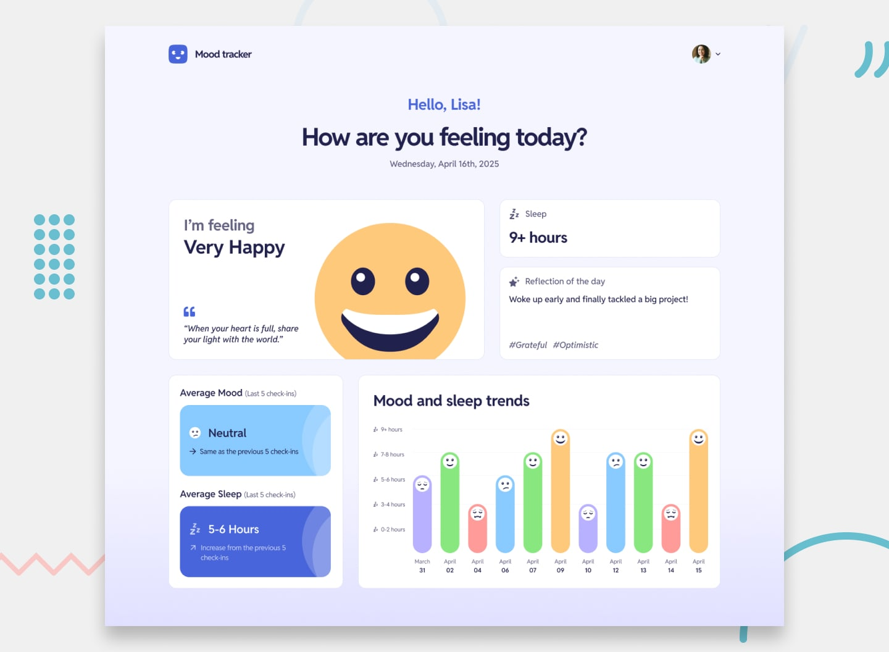

# Frontend Mentor - Mood tracking app solution

This is a solution to the [Mood tracking app challenge on Frontend Mentor](https://www.frontendmentor.io/challenges/mood-tracking-app-E2XeKhDF0B). Frontend Mentor challenges help you improve your coding skills by building realistic projects.

## Table of contents

- [Overview](#overview)
  - [The challenge](#the-challenge)
  - [Screenshot](#screenshot)
  - [Links](#links)
- [My process](#my-process)
  - [Built with](#built-with)
  - [Getting started](#getting-started)
  - [What I learned](#what-i-learned)
  - [Continued development](#continued-development)
  - [Useful resources](#useful-resources)
  - [AI Collaboration](#ai-collaboration)
- [Author](#author)

## Overview

### The challenge

Users should be able to:

- Log their mood, feelings, reflections, and sleep each day
- See today's mood, feelings, reflection, and sleep, once logged
- See a relevant mood quote based on today's mood
- See a graph showing the most recent eleven records to identify mood and sleep trends
- Interact with each bar on the mood and sleep trends chart to see all information about that day
- See their average mood and sleep from the past five check-ins and see how they compare with the previous five
- Update their name or avatar through settings
- View the optimal layout for the interface depending on their device's screen size
- See hover and focus states for all interactive elements on the page
- **Bonus**: Save details to a database (built as a full-stack app)
- **Bonus**: Create an account and log in (user authentication)
- **Bonus**: Integrate with a third-party image-hosting service for the avatar upload

### Screenshot



<!-- TODO: replace with a screenshot of your finished solution -->

### Links

- Solution URL: [Add solution URL here](https://your-solution-url.com)
- Live Site URL: [https://mood-tracking-flame.vercel.app](https://mood-tracking-flame.vercel.app/)

## My process

### Built with

This is a full-stack monorepo managed with [pnpm](https://pnpm.io/) workspaces.

**Client** (`/client`)

- [React 19](https://react.dev/) + [TypeScript](https://www.typescriptlang.org/)
- [Vite](https://vite.dev/) - build tool
- [Tailwind CSS 4](https://tailwindcss.com/) - styling
- [React Router](https://reactrouter.com/) - routing
- [TanStack Query](https://tanstack.com/query) - server state and data fetching
- [React Hook Form](https://react-hook-form.com/) - forms
- [Headless UI](https://headlessui.com/) - accessible UI primitives
- [Axios](https://axios-http.com/) and [React Hot Toast](https://react-hot-toast.com/)
- Mobile-first workflow

**Server** (`/server`)

- [Node.js](https://nodejs.org/) + [Express 5](https://expressjs.com/)
- [MongoDB](https://www.mongodb.com/) with [Mongoose](https://mongoosejs.com/)
- JWT authentication with `bcryptjs` password hashing
- Security middleware: `helmet`, `express-rate-limit`, `express-mongo-sanitize`, `hpp`, CORS
- `multer` for avatar uploads, `nodemailer` + SendGrid for email
- [Swagger UI](https://swagger.io/tools/swagger-ui/) API docs (OpenAPI spec in `server/docs`)

### Getting started

**Prerequisites:** Node.js, pnpm, and a MongoDB database.

1. Clone the repository and install dependencies:

   ```bash
   git clone https://github.com/hsu-sam/mood-tracking-app.git
   cd mood-tracking-app
   pnpm install
   pnpm --dir client install
   pnpm --dir server install
   ```

2. Configure the server environment:

   ```bash
   cp server/example.env server/.env
   ```

   Then fill in the values (database credentials, `JWT_SECRET`, `JWT_EXPIRES_IN`, `CLIENT_URL`, `CORS_ORIGINS`, and the email/SendGrid settings).

3. Run the app:

   ```bash
   pnpm dev            # client and server together
   pnpm dev:client     # client only (Vite, http://localhost:5173)
   pnpm dev:server     # server only (nodemon)
   ```

4. Build the client for production:

   ```bash
   pnpm build
   ```

### What I learned

<!-- TODO: recap your major learnings, with code snippets you're proud of. -->

### Continued development

<!-- TODO: areas you want to keep improving in future projects. -->

### Useful resources

- [Example resource](https://www.example.com) - Replace with resources that helped you during the challenge.

### AI Collaboration

<!-- TODO: describe which AI tools you used, how, and what worked or didn't. Delete if not applicable. -->

## Author

- Website - [Add your name here](https://www.your-site.com)
- Frontend Mentor - [@yourusername](https://www.frontendmentor.io/profile/yourusername)
- GitHub - [@hsu-sam](https://github.com/hsu-sam)
